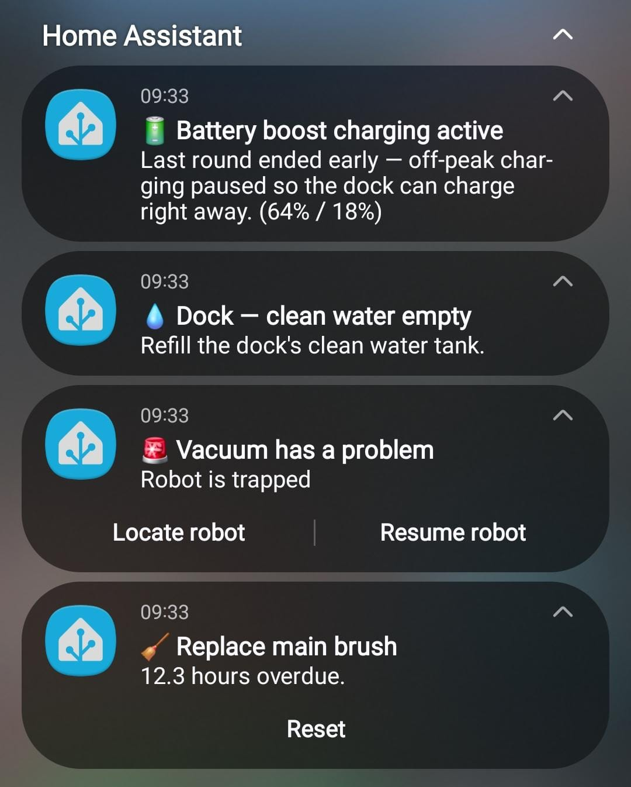
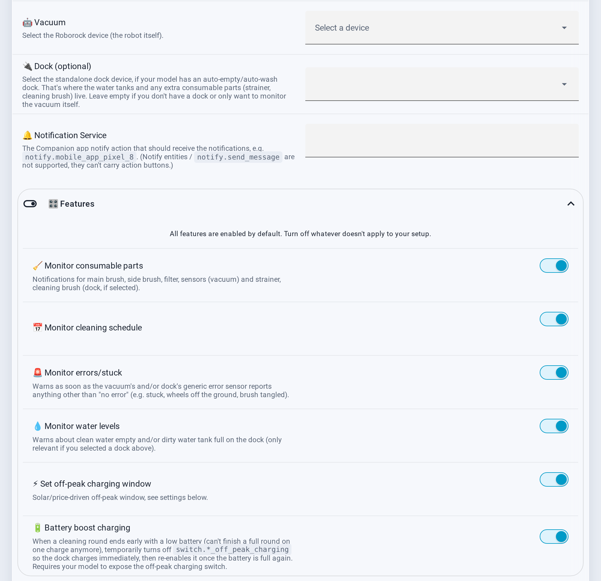
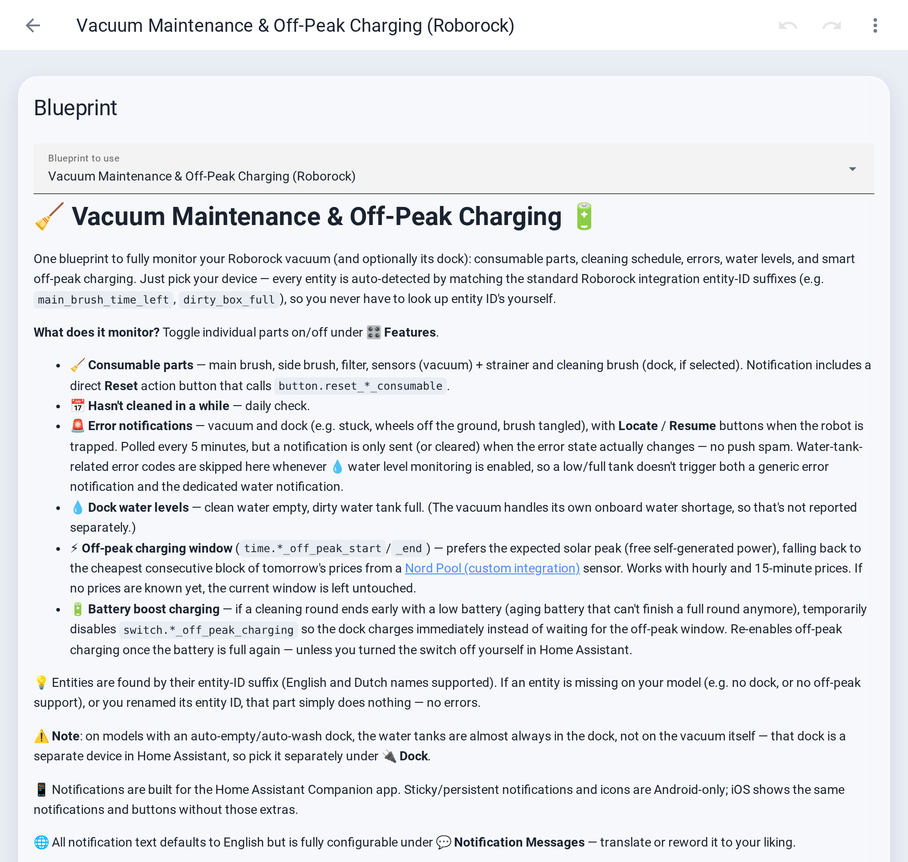
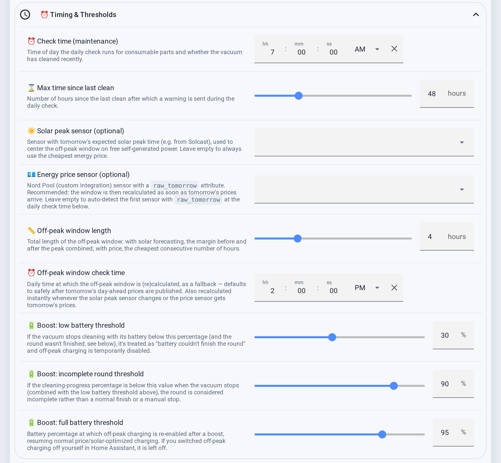

# Home Assistant blueprints

Blueprints I use in my own Home Assistant and share with the community.

| Blueprint | Description |
| --- | --- |
| [🧹 Vacuum Maintenance & Off-Peak Charging (Roborock)](#-vacuum-maintenance--off-peak-charging-roborock) | Consumables, errors, dock water levels and solar/price-driven off-peak charging for Roborock vacuums |
| [Tibber Smart Charging — Departure Times from Calendar](#tibber-smart-charging--departure-times-from-calendar) | Sets the weekly Tibber smart-charging departure times from your calendar |

---

## 🧹 Vacuum Maintenance & Off-Peak Charging (Roborock)

One blueprint to monitor a Roborock vacuum (and optionally its dock) through the
official [Roborock integration](https://www.home-assistant.io/integrations/roborock/).
Pick the vacuum and dock devices; all entities are detected automatically.

Setup screenshots

### Features

- 🧹 **Consumable parts**: main brush, side brush, filter and sensors on the vacuum,
  strainer and cleaning brush on the dock. The notification has a **Reset** button
  that presses the matching `button.reset_*_consumable`.
- 📅 **Hasn't cleaned in a while**: daily check against the last clean.
- 🚨 **Errors**: vacuum and dock error sensors with readable names, which you can
  override or translate. **Locate** and **Resume** buttons when the robot is trapped
  or its wheels are off the ground. A notification is only sent or cleared when the
  state changes.
- 💧 **Dock water levels**: clean water tank empty, dirty water tank full.
- ⚡ **Off-peak charging window**: sets `time.*_off_peak_start` / `_end` around
  tomorrow's solar peak (for example from Solcast), or otherwise on the cheapest
  consecutive block of tomorrow's [Nord Pool](https://github.com/custom-components/nordpool)
  prices. Works with both hourly and 15-minute prices.
- 🔋 **Battery boost**: if a round ends early on a low battery (an aging battery that
  can't finish a full round), off-peak charging is paused so the dock charges right
  away. It is switched back on once the battery is full.
- 🌐 Every notification text can be changed, so you can translate the blueprint
  completely.

Each feature can be switched off on its own.

### Requirements

- Home Assistant **2024.10** or newer
- The Roborock integration
- The [Companion app](https://companion.home-assistant.io/) for notifications
  (`notify.mobile_app_*`)
- Optional: a solar forecast sensor with a timestamp of tomorrow's peak, and/or a
  Nord Pool (custom integration) price sensor with a `raw_tomorrow` attribute

### Good to know

- **Entity detection** works by entity-ID suffix (for example `_main_brush_time_left`,
  `_dirty_box_full`). English and Dutch entity names are supported. If you renamed
  an entity ID, or your model doesn't have the entity, that feature does nothing.
  There are no errors.
- **Dock**: on auto-empty/auto-wash models the dock is a separate device in Home
  Assistant. Select it under *🔌 Dock* for water levels and dock consumables.
- **Errors and water levels** are checked every 5 minutes. A push message is only
  sent when a state changes, so the 500-per-day push limit of the Companion app is
  not at risk.
- **Off-peak window**: if neither a solar peak nor tomorrow's prices are available,
  the current window is left unchanged. Select the price sensor in the blueprint so
  the window is recalculated as soon as tomorrow's prices arrive.
- **Battery boost** turns `switch.*_off_peak_charging` back on at the "full"
  threshold. It does not do this if you switched it off yourself in Home Assistant.
- **iOS**: notifications and buttons work. Sticky/persistent notifications and
  custom icons are Android-only.
- **Multiple vacuums**: create one automation per vacuum. Notification tags and
  buttons are unique per robot.

### Changelog

- **2026-11-22**: first public release. Errors and water levels now only notify on a
  state change, and the off-peak window supports 15-minute prices. There is a new
  price sensor input, and the window is kept when no prices are known. Notification
  buttons are only handled by the instance that owns the entities, and tags are
  unique per vacuum. The optional dock picker no longer
  shows "unknown device" when left empty.

## Tibber Smart Charging — Departure Times from Calendar

Tibber smart charging needs a departure time for each weekday. This blueprint keeps
those in sync with a calendar, so the car is ready when you actually leave and
Tibber can charge at the cheapest hours on days you stay home.

Every day at a time you choose, it reads the next 7 days of the calendar and works
out a departure time for each weekday:

- 🏢 **Keyword events**: an event whose title contains one of your keywords (for
  example `office`) sets a fixed departure time (default 07:30).
- 🏷️ **Tagged events**: an event whose title contains the tag (default `[car]`,
  for example *Dentist [car]*) sets the departure time to the event start minus an
  offset (default 60 minutes). All-day tagged events use the fixed time.
- 🕳️ **No matching event**: the departure time for that day is cleared, or left
  as it is if you switch that option off.

With several matching events on one day, the earliest time wins. Only days that
change are sent to Tibber.

### Features

- 📋 Optional persistent notification with the week plan and what changed,
  dismissed automatically after a time you choose.
- 🚨 Your own actions (for example a phone notification) when the calendar can't
  be read. The departure times are left alone in that case.
- 🌐 Weekday names and summary texts can be changed, so you can translate it.
- 🔄 Optionally reloads the integration first, so changes made in the Tibber app
  are seen before comparing.

### Requirements

- Home Assistant **2024.10** or newer
- The [Tibber Grid Reward](https://github.com/JohNan/homeassistant-tibber_grid_rewards)
  custom integration (HACS), which provides `tibber_grid_reward.set_departure_time`
  and the `time.*_departure_time_<weekday>` entities
- A calendar entity (Google, CalDAV, local calendar, ...)

### Good to know

- **Entity detection**: the departure-time entities of the selected car are found
  by their entity-ID suffix (`_departure_time_monday` and so on). If you renamed
  them, that day is skipped and named in the logbook entry.
- **7 days**: Tibber stores one time per weekday, so planning further ahead isn't
  possible.
- **Event dates**: an event counts for the day it starts on.
- **Multiple cars**: create one automation per car.

### Changelog

- **2026-11-22**: first public release.

## License

[MIT](LICENSE)
